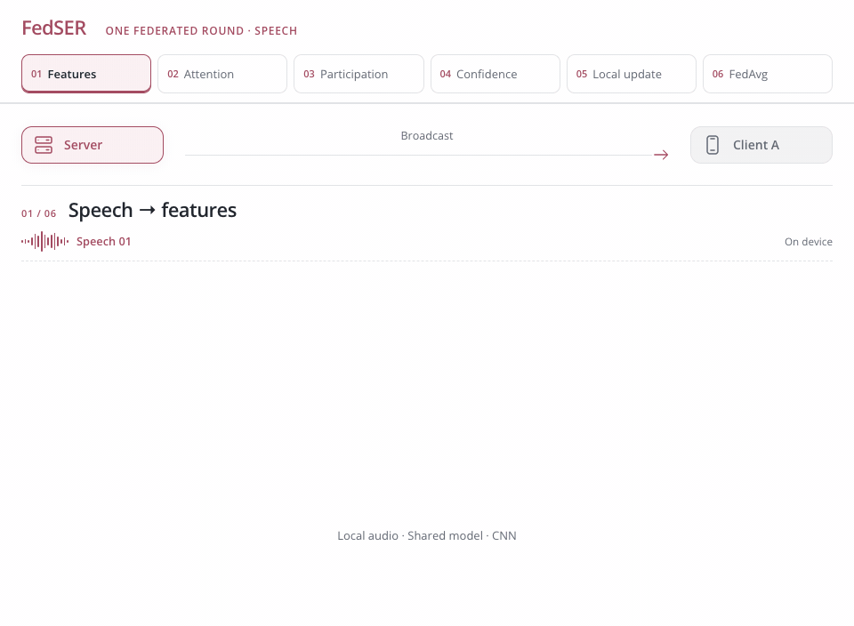

<h1 align="center">FedSER</h1>
<p align="center"><strong>Privacy-preserving Speech Emotion Recognition through Semi-Supervised Federated Learning</strong></p>
<p align="center"><a href="https://vtsouval.github.io/"><strong>Vasileios Tsouvalas</strong></a> · Tanir Özçelebi · Nirvana Meratnia</p>

<p align="center">
  <a href="https://doi.org/10.1109/PerComWorkshops53856.2022.9767445" title="Read the paper"></a>
  <picture></picture>
  <a href="https://nousphera.github.io/FedSER/" title="Explore the project"></a>
  <picture></picture>
  <a href="https://nousphera.github.io/assets/posters/fedser-a0-landscape.pdf" title="View the poster"></a>
</p>

## Abstract

**FedSER** learns *speech emotion recognition* from **few labeled utterances** and *on-device unlabeled speech*. A compact CNN uses **spectral, temporal and channel attention** to capture emotional cues. Each client learns from its labels and **confidence-filtered pseudo-labels**, with a *device-specific threshold* driven by global progress and local participation. The server combines model updates through **sample-weighted aggregation**, while raw recordings remain on each device. Experiments on **IEMOCAP** examine *speaker-independent and overlapping-speaker evaluation* under random and per-speaker client distributions.

<p align="center">
  <a href="docs/assets/readme/method-light.mp4" title="Watch the method video">
    <picture>
      <source media="(max-width: 600px) and (prefers-color-scheme: dark)" srcset="docs/assets/readme/method-dark-mobile.gif">
      <source media="(max-width: 600px)" srcset="docs/assets/readme/method-light-mobile.gif">
      <source media="(prefers-color-scheme: dark)" srcset="docs/assets/readme/method-dark.gif">
      
    </picture>
  </a>
</p>

## Setup

Create and activate the `fedser` environment:

```bash
git clone https://github.com/Nousphera/FedSER.git
cd FedSER
python3.12 -m venv --prompt fedser "$HOME/.venvs/fedser"
source "$HOME/.venvs/fedser/bin/activate"
```

From the activated `fedser` environment, install the requirements:

```bash
python -m pip install -r requirements.txt
```

## Data and Weights

Obtain [IEMOCAP](https://sail.usc.edu/iemocap/) from USC and extract it under `data/raw/iemocap/`, retaining `Session*/dialog/EmoEvaluation/` and `Session*/sentences/wav/`. Prepare and validate the corpus:

```bash
python scripts/prepare_data.py

# An existing corpus elsewhere
python scripts/prepare_data.py --source-dir /path/to/IEMOCAP_full_release
```

> [!NOTE]
> Uses **improvised speech** labeled **neutral, happy, sad or angry**. Add `--merge-excited` to include *excited* utterances in the happy class.

### Prepare Model

The **four-block CNN with spectro-temporal-channel attention** trains from scratch; no pretrained weights are required.

## Run Experiments

From the repository root, launch your chosen method as a **Flower App**:

```bash
# Shared experiment settings
common=(--protocol session --fold 1 --partition random --nr-clients 10
        --rounds 100 --participation 0.8 --quantity-variation 0.25
        --labeled-fraction 0.1 --local-epochs 1 --batch-size 64
        --learning-rate 0.001)

# FedSER (ours) · self-training
python scripts/run_experiment.py "${common[@]}" --method fedser

# FedAvg · the same labeled utterances
python scripts/run_experiment.py "${common[@]}" --method fedavg

# Fully supervised FL · all labels
python scripts/run_experiment.py "${common[@]}" --method fedavg --labeled-fraction 1

# Centralized · all labels
python scripts/run_experiment.py "${common[@]}" --method centralized --labeled-fraction 1

# Per-speaker clients · automatically match the training speakers
python scripts/run_experiment.py "${common[@]}" --partition speaker --nr-clients 0

# Overlapping speakers · stratified five-fold evaluation
python scripts/run_experiment.py "${common[@]}" --protocol overlap
```

> [!NOTE]
> FedSER pairs equal labeled/unlabeled batches with **T = 2**, **β = 0.5** and a participation-adjusted confidence threshold starting at **0.5**. Evaluation averages segment probabilities and reports **unweighted accuracy**. Metrics and weights are saved under `results/`.

Use `--fold 1` through `5` and repeat each fold with five `--seed` values; `--data-seed` keeps folds and label selections fixed. Speaker partitions retain all training speakers: **8** for session holdout and **10** for overlapping-speaker evaluation.

## Citation

```bibtex
@inproceedings{tsouvalas2022fedser,
  author = {Tsouvalas, Vasileios and Ozcelebi, Tanir and Meratnia, Nirvana},
  title = {Privacy-preserving Speech Emotion Recognition through Semi-Supervised Federated Learning},
  booktitle = {2022 IEEE International Conference on Pervasive Computing and Communications Workshops and other Affiliated Events (PerCom Workshops)},
  year = {2022},
  pages = {359--364},
  doi = {10.1109/PerComWorkshops53856.2022.9767445},
  url = {https://doi.org/10.1109/PerComWorkshops53856.2022.9767445}
}
```
